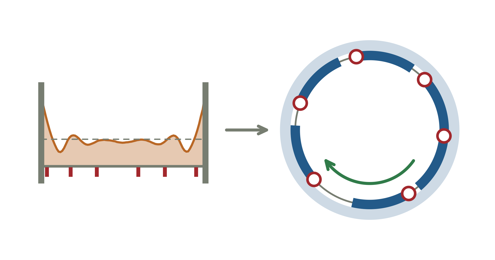

```{r setup}
#| include: false
library(ggplot2)
theme_set(
  theme_minimal(base_size = 12) +
    theme(panel.grid.minor = element_blank(),
          plot.title = element_text(face = "bold"),
          plot.subtitle = element_text(colour = "grey35"))
)
COL <- c(circular = "#2C6E9B", sequential = "#C77B30",
         theory = "#B33A3A", ok = "#3B8B5B")
set.seed(20260810)
```

```{r sampler-early}
#| include: false
# identical to the visible `sampler` chunk in "The Fix"; defined here because
# the bias simulation (which comes first) already needs it
circ_offsets <- function(cfg) {
  n <- cfg$slots
  e <- diff(c(0, sort(runif(n - 1)), 1)) * cfg$slack
  s <- cfg$min_gap + e
  phase <- runif(1) * cfg$width
  sort(floor((phase + cumsum(c(0, s[-n]))) %% cfg$width))
}
```

{fig-alt="Left: ping times on a day bounded by two walls pile up at the edges. Right: the same day wrapped into a circle, where every time is equally likely."}

Most experience sampling (ESM) studies need two things from their ping schedule. Pings should be far
enough apart that two questionnaires are never open at the same time, and every
time of day should be equally likely to be sampled. That sounds like the bare
minimum.

It turns out the schemes in use deliver one or the other, but not both. I went
looking, and each construction I found gives up something different (the
comparison is further down):

> **A fixed number of pings, a hard minimum gap, and a flat distribution; so on
> an interval, pick two.**

What you pay depends on which one you give up. Let pings get too close, and
with the most common scheme about one day in three has a ping whose reminder
chain runs into the next one: data you either throw away or cannot trust. Keep
the gap, and the bill arrives elsewhere: either parts of the day become
unreachable (with six pings 90 minutes apart in a 12-hour day, a windowed
scheduler can never ping in about 62 % of it), or you get a time-of-day bias
that more participants will not average away.

None of this is necessary. There is a simple, exact fix that costs a few lines
of R: wrap the day into a circle and rotate it randomly.
Whether you need it at all depends on your design, and there is a quick way to
check. That is the next section, and if it says you are fine, you can stop
reading and go and do something more fun.

## Does This Apply to Your Study?

Depending on your ESM design, you might not need to worry about any of this.
It comes down to **how much of the day your minimum gaps commit**: pings per
day, times the minimum separation, divided by the length of the sampled window
(I write that as $nG/W$ further down).

| design | $nG/W$ committed | is there a problem? |
|---|---|---|
| 3 pings, 90 min apart, 12-h day | 38 % | no |
| 4 pings, 90 min apart, 12-h day | 50 % | barely |
| 6 pings, 90 min apart, 12-h day | 75 % | yes |
| 6 pings, 120 min apart, 12-h day | 100 % | no schedule has any freedom left |

If your design commits roughly half the day or more, read on.

**If you want a distinct morning ping, a midday ping, and an evening ping, none
of this touches you.** Two separate reasons:

First, your design might be *stratified on purpose*. You probably want one measurement
inside each of three named periods, and your estimand is the morning mean, the midday mean, the
evening mean. Uniformity across the whole day is not something you are trying
to achieve.

Second, even if you did want whole-day uniformity, at three pings the design is
too loose for the problem to bite. Three 90-minute gaps commit 38 % of a
12-hour day, which leaves plenty of room. Only about 7 % of adjacent pairs would
land closer than 90 minutes at all, so even plain block randomisation keeps the
gap on 86 % of days.


## ESM Ping Scheduling Constraints

I will use one concrete study I had the opportunity to work on as an example: 
participants carry a phone for 18 days, and on each day they get 
$n = 6$ *pings*: a notification inviting them to
fill in a short questionnaire about what they are doing and feeling right now.
The numbers are mine, but nothing below depends on them. Everything that
follows is a function of three variables: how many pings a day, how far apart
they must be, and how long the sampled window is. I come back to which
combinations of those the method handles after describing the circle trick.

Four things are true of that design (and many other ESM designs, I think):

**Every ping is structurally identical.** After every
ping, you give participants an identical notification (etc.) and
the same amount of time to answer the questionnaire.

**A ping is an invitation plus an allowed response window $t$.** After $t$ the
invitation expires and the ping is recorded as missed. So every ping occupies an
interval of fixed length on the time axis, starting when it is issued.

**No ping may be issued while the previous one is still open.** Two overlapping
invitations mean two open questionnaires: the participant can answer them out of
order, or answer one about the other's moment, and the platform generally cannot
tell which happened. This we must prevent.

**The pings must sample the day uniformly.** The goal of our ESM
study is that the sampled moments represent sampled life. If some hours are more
likely to be sampled than others, the picture of said person's life is distorted.
Moreover, because every participant runs the same scheduler, the distortion does not
average out across the sample.

```{r fig-anatomy}
#| code-fold: true
#| fig-height: 3.1
#| fig-cap: "Why the pings cannot be treated as instants. The minimum gap has to be at least as long as the window the questionnaire stays open."
par(mar = c(2.6, 0.6, 2.2, 0.6))
plot(NA, xlim = c(0, 240), ylim = c(3.75, 0.25), axes = FALSE, xlab = "", ylab = "",
     main = "A ping occupies the time its questionnaire stays open")
axis(1, at = seq(0, 240, 30), labels = paste0(seq(0, 240, 30), " min"),
     cex.axis = 0.66, col = "grey60", col.axis = "grey35", tck = -0.03, mgp = c(2, 0.4, 0))
lighten <- function(hex, a) adjustcolor(hex, alpha.f = a)
bar <- function(x0, y, w, col, mark = "grey25") {
  rect(x0, y - 0.22, x0 + w, y + 0.22, col = col, border = NA)
  segments(x0, y - 0.34, x0, y + 0.34, col = mark, lwd = 2.4)
}
bar(30, 1, 30, lighten(COL["circular"], 0.35))
text(30, 1.62, "notification sent", cex = 0.62, col = "grey25", pos = 4, offset = 0.15)
text(60, 1, "questionnaire open (t = 30 min)", cex = 0.62, col = "grey20", pos = 4, offset = 0.4)
segments(30, 1.28, 60, 1.28, col = "grey45"); segments(c(30, 60), 1.22, c(30, 60), 1.34, col = "grey45")

bar(30, 2.3, 30, lighten(COL["theory"], 0.30), COL["theory"])
bar(48, 2.3, 30, lighten(COL["theory"], 0.30), COL["theory"])
rect(48, 2.08, 60, 2.52, col = lighten(COL["theory"], 0.55), border = NA)
text(95, 2.3, "two questionnaires open at once - answers cannot be tied to a moment",
     cex = 0.62, col = COL["theory"], pos = 4, offset = 0.2)

bar(30, 3.5, 30, lighten(COL["ok"], 0.30), COL["ok"])
bar(120, 3.5, 30, lighten(COL["ok"], 0.30), COL["ok"])
segments(30, 3.16, 120, 3.16, col = "grey45")
segments(c(30, 120), 3.10, c(30, 120), 3.22, col = "grey45")
text(75, 3.02, "minimum gap G, at least as long as t", cex = 0.62, col = "grey25")
text(155, 3.5, "never overlapping, whatever the participant does",
     cex = 0.62, col = COL["ok"], pos = 4, offset = 0.2)
```

The first three say pings cannot be close together. The fourth says the
distribution of ping times has to be flat. Reconciling those two
demands is the problem we will solve.

## The Variables

Three numbers set up the whole problem: $n$, the number of pings per day; $G$,
the minimum gap between consecutive pings, which has to be at least the response
window $t$; and $W$, the width of the sampled window in minutes. Whatever is
left once every ping has claimed its minimum gap is the **slack**,
$S = W - nG$. In my example:

```{r config}
circ_config <- function(days = 18, slots = 6, start_h = 9, end_h = 21,
                        min_gap = 90, window = 30) {
  cfg <- list(days = days, slots = slots, start_h = start_h, end_h = end_h,
              min_gap = min_gap, window = window)
  cfg$width <- (end_h - start_h) * 60          # W
  cfg$n     <- days * slots
  cfg$slack <- cfg$width - slots * min_gap     # S, the circular slack
  cfg$max_gap <- cfg$width - (slots - 1) * min_gap
  cfg
}
cfg <- circ_config()
data.frame(symbol = c("W", "n", "G", "S", "t"),
           meaning = c("width of sampled window (min)", "pings per day",
                       "minimum separation (min)", "slack, W - nG",
                       "allowed response window (min)"),
           value = c(cfg$width, cfg$slots, cfg$min_gap, cfg$slack, cfg$window))
```

Why 90 and not 30? The questionnaire is open for 30 minutes, but a ping
occupies more than that. In our study, a ping was a chain: a wait after the push
notification, a reminder e-mail, a second wait after the reminder, and then the
time a participant still has to finish a questionnaire they started just before
it closed. Depending on software and implementation, that chain alone can take
up to about 45 minutes, and that is the hard floor for $G$. We put a safety
margin on top of it and landed at 90. Nothing below depends on the exact value;
$G$ only has to be at least as long as your full ping chain.

tldr: Six pings, ninety minutes each: that's nine of the twelve hours already spoken
for. The slack is `r cfg$slack` minutes for the whole day. So what do we do with it normally?

## What Schedulers Currently Do

There is no single thing the field does. I went looking and found four
constructions, each failing in a different place: three documented in methods
guides or platforms, and one that is the natural thing to write yourself.
I may not be aware of this problem being discussed; however, recent
overview literature does not make note of such discussions (Myin-Germeys & Kuppens, 2026).
Back to the used methods:

**Block randomisation.** Split the window into $n$ equal blocks
and put one ping uniformly inside each. It is what I have found in methods guides: 
e.g. for the Experience Sampling Program (ESP): "divide the time range into $N$ equal intervals and present one beep
randomly within each interval" (Conner Christensen et al., 2003).

**Blocks with a pushed-forward minimum gap** is what movisensXS does with its
"Random Time Play" trigger: split the window into $n$ equal blocks, one ping per
block, and enforce a "Minimum Time Between Prompts" by moving the start of the
next block. In their own example, a ping at 09:50 with a 30-minute minimum puts
the next one "between 10:20 and 12:00" (movisens GmbH, 2026).

**Windowed scheduling with expiry** is another way of scheduling pings. SEMA3
(O'Brien et al., 2024) has the researcher define survey *windows*, fires the
notification uniformly inside each window, and enforces that "survey windows
(including their expiry time portion) cannot overlap." That last clause is the
minimum separation constraint, taken seriously and solved at the level of the schedule.

**The interval with walls** is the fourth. I have not found it documented in a
platform, but it is what you get if you build your own scheduler and do the
textbook thing: draw $n$ uniforms on the reduced
interval $[0, W - (n-1)G]$, sort, and re-inflate by the reserved gaps. This is
uniform over admissible position vectors *on a line*, which sounds like the
right thing. (Drawing uniforms on the whole day and redrawing until the gaps are
legal is not a different method, because conditioning on the constraint gives this 
same distribution, just more slowly.)

Let's look at where that leaves us:

```{r schemes}
seq_offsets <- function(cfg) {                      # interval with walls
  slack <- cfg$width - (cfg$slots - 1) * cfg$min_gap
  sort(runif(cfg$slots) * slack) + (seq_len(cfg$slots) - 1) * cfg$min_gap
}
block_offsets <- function(cfg) {                    # equal blocks, one ping each
  b <- cfg$width / cfg$slots
  (seq_len(cfg$slots) - 1) * b + runif(cfg$slots) * b
}
block_repair <- function(cfg) {                     # ... redrawn until gaps are legal
  repeat { x <- block_offsets(cfg); if (all(diff(x) >= cfg$min_gap)) return(x) }
}
block_push <- function(cfg) {                       # ... next block starts no earlier than prev + G
  b <- cfg$width / cfg$slots
  x <- numeric(cfg$slots); prev <- -Inf
  for (k in seq_len(cfg$slots)) {
    lo <- max((k - 1) * b, prev + cfg$min_gap)
    x[k] <- lo + runif(1) * (k * b - lo); prev <- x[k]
  }
  x
}
sema_offsets <- function(cfg, sep = cfg$window) {   # windows separated by the expiry
  d <- (cfg$width - (cfg$slots - 1) * sep) / cfg$slots
  (seq_len(cfg$slots) - 1) * (d + sep) + runif(cfg$slots) * d
}
```

```{r fig-schemes}
#| code-fold: true
#| fig-height: 12.6
#| fig-cap: "Ten simulated days under each construction, with the distribution those days pool into underneath. A red bar joins any two pings less than 90 minutes apart - the bar is the gap that is too short. Pink bands are minutes where no ping can ever start. The dashed line under each strip is the flat target. The two windowed rows are the same platform at two settings, and show the choice it forces."
set.seed(6)
schemes <- list(
  list(f = block_offsets, lab = "block randomisation",       sub = "flat, but pings can collide"),
  list(f = block_repair,  lab = "block + redraw until legal", sub = "gap fixed, flatness lost"),
  list(f = block_push,    lab = "block + pushed-forward gap (movisensXS)",
       sub = "gap fixed, but the start of every later block is starved"),
  list(f = function(cfg) sema_offsets(cfg, 30), lab = "windows + expiry, 30 min apart",
       sub = "no two open at once, but gaps far below 90 min"),
  list(f = function(cfg) sema_offsets(cfg, 90), lab = "windows + expiry, 90 min apart",
       sub = "gaps fixed, and now 62% of the day is unreachable"),
  list(f = seq_offsets,   lab = "interval with walls",        sub = "gap fixed, mass piles at the edges"))

layout(matrix(1:12, 12, 1), heights = rep(c(3, 1.5), 6))
par(oma = c(3.2, 0.6, 0.6, 0.6))
brks <- seq(0, cfg$width, by = 10)
ND <- 60000                      # same as the table below, so the unevenness values agree
for (sc in schemes) {
  M <- t(replicate(ND, sc$f(cfg)))
  x <- as.vector(M)
  fine <- as.numeric(table(cut(x, seq(0, cfg$width, by = 1), right = FALSE)))
  dead <- which(fine == 0)

  # --- ten example days ---
  par(mar = c(0.4, 0.6, 2.6, 0.6))
  plot(NA, xlim = c(0, cfg$width), ylim = c(10.8, 0.2), axes = FALSE, xlab = "", ylab = "")
  if (length(dead)) for (r in split(dead, cumsum(c(1, diff(dead) != 1))))
    rect(min(r) - 1, 0.2, max(r), 10.8, col = "#F2DEDE", border = NA)
  for (i in 1:10) {
    d <- sc$f(cfg)
    segments(0, i, cfg$width, i, col = "grey90", lwd = 0.8)
    tight <- which(diff(d) < cfg$min_gap)
    if (length(tight))
      segments(d[tight], i, d[tight + 1], i, col = COL["theory"], lwd = 3.2, lend = 1)
    bad <- logical(length(d)); bad[c(tight, tight + 1)] <- TRUE
    segments(d, i - 0.38, d, i + 0.38, col = ifelse(bad, COL["theory"], "grey30"),
             lwd = ifelse(bad, 2.6, 2.1), lend = 1)
  }
  title(main = sc$lab, adj = 0, cex.main = 0.95, line = 1.25)
  mtext(sc$sub, side = 3, adj = 0, line = 0.2, cex = 0.62, col = "grey35")

  # --- what those days pool into ---
  par(mar = c(0.9, 0.6, 0.3, 0.6))
  h <- hist(x, breaks = brks, plot = FALSE)
  flat <- length(x) / length(h$counts)
  top <- max(h$counts) * 1.42
  plot(NA, xlim = c(0, cfg$width), ylim = c(0, top), axes = FALSE, xlab = "", ylab = "")
  if (length(dead)) for (r in split(dead, cumsum(c(1, diff(dead) != 1))))
    rect(min(r) - 1, 0, max(r), max(h$counts) * 1.06, col = "#F2DEDE", border = NA)
  rect(head(h$breaks, -1), 0, tail(h$breaks, -1), h$counts,
       col = adjustcolor("grey30", 0.42), border = NA)
  segments(0, flat, cfg$width, flat, col = "grey25", lwd = 1.4, lty = 2)
  text(cfg$width, top, sprintf("unevenness = %.3f", sd(h$counts) / mean(h$counts)),
       adj = c(1, 1), cex = 0.68, col = "grey25")
  text(0, top, sprintf("pooled over %s days | dashed = flat", format(ND, big.mark = " ")),
       adj = c(0, 1), cex = 0.62, col = "grey45")
}
axis(1, at = seq(0, cfg$width, 120), labels = paste0(9 + seq(0, cfg$width, 120)/60, ":00"),
     cex.axis = 0.72, col = "grey60", col.axis = "grey35", tck = -0.03,
     mgp = c(2, 0.5, 0), outer = TRUE)
mtext("each row is one simulated day", side = 1, line = 2.0, outer = TRUE,
      cex = 0.6, col = "grey35")
```

Let's score them on the two things we defined as design constraints: a flat distribution,
and no two pings closer than $G$:

```{r scheme-table}
score <- function(f, cfg, N = 60000) {
  M <- t(replicate(N, f(cfg)))
  x <- as.vector(M)
  cnt  <- as.numeric(table(cut(x, seq(0, cfg$width, by = 10), right = FALSE)))
  fine <- as.numeric(table(cut(x, seq(0, cfg$width, by =  1), right = FALSE)))
  gaps <- as.vector(t(apply(M, 1, diff)))
  data.frame(unevenness = round(sd(cnt) / mean(cnt), 3),
             noise_floor = round(1 / sqrt(mean(cnt)), 3),
             pct_gaps_too_close = round(100 * mean(gaps < cfg$min_gap), 1),
             pct_day_unreachable = round(100 * mean(fine == 0), 1))
}
do.call(rbind, lapply(
  list(`block random`       = block_offsets,
       `block + repair`     = block_repair,
       `block + push`       = block_push,
       `windows, sep = 30`  = function(cfg) sema_offsets(cfg, 30),
       `windows, sep = 90`  = function(cfg) sema_offsets(cfg, 90),
       `interval w/ walls`  = seq_offsets), score, cfg = cfg))
```

Read `unevenness` (against its `noise_floor`) and `pct_gaps_too_close` as the two
requirements, and `pct_day_unreachable` as the price of meeting the second. **No
scheme here satisfies both.**

- **Block randomisation is exactly uniform** — its `unevenness` sits on the counting
  noise floor. But that's because it is very rude to our minimum separation:
  more than a quarter of adjacent pings land closer than 90 minutes, and two pings can arrive
  seconds apart across a block boundary.
- **Repairing it makes it worse.** Redrawing until the minimum separations
  are legal costs a factor of ten in draws and lands at an `unevenness` above the walled
  sampler's.
- **Pushing the next block forward is worse still.** It guarantees the gap by
  construction, and nothing is unreachable, but a ping late in one block
  pushes the next one late too. The first minutes of every block after the first
  are almost never sampled, and their ends up to about twice as often as
  they should be. Of the schemes that can reach every minute of the day, this
  sawtooth is the least flat.
- **The windowed scheme enforces the gap directly, and pays in coverage.**
  The smallest possible gap is exactly the separation you
  configure, because the tightest case is a ping at the very end of one window and
  the next at the very start of the following one. That is also the cost. Separate
  the windows by one expiry, 30 minutes, and you have solved the constraint 
  — no two questionnaires open at once — but every gap down to 30
  minutes is still legal, so a design asking for 90 does not get it. That is why
  the first windowed row above is full of red. Ask for the full 90 and the
  costs rise accordingly: five 90-minute separations between six windows leave 45-minute windows, and **62 %
  of the sampled day becomes unreachable**. Separation and coverage trade against
  each other one for one, and the platform cannot give you both.
- **The walled interval respects the minimum separation and looks promising at first, 
  but pays at the edges**.

I do not want to imply that these methods are done carelessly. This is the
"pick two" from the top of the post, and on an interval it is a real constraint.

## What Each Failure Costs You

`unevenness` and red bars are not things anyone designs a study around, so
let's translate them into data.

### Pings That Collide

What counts as "too close" depends on how long one ping really occupies: at
least the 30-minute response window, in our study the full 45-minute chain with
the reminder, and at most the 90 minutes the design asked for. Counting the later
ping of every too-close pair as lost:

```{r collisions}
chain <- 45   # push, wait, reminder e-mail, wait, grace for a started questionnaire
lost <- function(thr, f, cfg, n_days = 20000) {
  D <- t(replicate(n_days, f(cfg)))
  per_day <- rowSums(D[, -1] - D[, -cfg$slots] < thr)
  per_person <- colSums(matrix(per_day[seq_len(cfg$days * (n_days %/% cfg$days))],
                               nrow = cfg$days)) / (cfg$days * cfg$slots)
  data.frame(gap_below = thr,
             pct_days_with_clash = round(100 * mean(per_day > 0), 1),
             pct_pings_lost = round(100 * mean(per_day) / cfg$slots, 1),
             pct_people_losing_10pct = round(100 * mean(per_person >= 0.10), 1))
}
thr <- c(cfg$window, chain, cfg$min_gap)
collide <- rbind(
  cbind(scheme = "block random", do.call(rbind, lapply(thr, lost, f = block_offsets, cfg = cfg))),
  cbind(scheme = "windows, sep = 30",
        do.call(rbind, lapply(thr, lost, f = function(cfg) sema_offsets(cfg, 30), cfg = cfg))))
collide
```

With block randomisation, `r collide$pct_days_with_clash[2]` % of days have a
ping whose chain runs into the next one, and that is before anyone has ignored a
single notification. Compliance across ESM studies averages 79 % (Wrzus &
Neubauer, 2023), so these losses come on top, and they can push participants who
were already close to your exclusion cutoff below it. The windowed scheme at a
30-minute separation never has two questionnaires open, but its reminder chains
still collide on `r collide$pct_days_with_clash[5]` % of days. And a lost ping is
the good case: with two questionnaires open, someone may answer the second about
the first moment, and nothing in the data will tell you.

### Hours You Never Sample

Separate the windows by the full 90 minutes and no ping is lost, but about 62 %
of the day can never be sampled. Whatever happens in those hours is simply not
in your data.

### A Skewed Day

Of the schemes above that keep the gap and still reach the whole day, the
interval with walls is the flattest, so it is the kindest test case. Let's simulate a plausible case: a diurnal signal shaped like a
cosine with an amplitude of 0.3 SD, which stands in for e.g. a daily mood cycle,
and see what the walled interval does to the estimated mean, compared with the
circular sampler introduced in the next section (flat by construction).

```{r bias-sim}
n_bias <- 300000
mu_fn  <- function(t) 0.3 * cos(2 * pi * (t - 430) / cfg$width)   # a hypothetical diurnal profile
x_seq  <- as.vector(replicate(n_bias, seq_offsets(cfg)))
x_circ <- as.vector(replicate(n_bias, circ_offsets(cfg)))
bias_seq  <- mean(mu_fn(x_seq))
bias_circ <- mean(mu_fn(x_circ))
data.frame(sampler = c("interval with walls", "circle"),
           bias_SD = round(c(bias_seq, bias_circ), 4))
```

```{r bias-context}
#| include: false
se_person <- 1 / sqrt(cfg$days * cfg$slots)
ratio_1   <- abs(bias_seq) / se_person
icc       <- 0.4                                  # share of variance between people
m         <- cfg$days * cfg$slots
se_grand  <- function(N) sqrt(icc / N + (1 - icc) / (N * m))
ratio_100 <- abs(bias_seq) / se_grand(100)
n_1se     <- signif((icc + (1 - icc) / m) / bias_seq^2, 1)   # N where bias = 1 SE
```

```{r fig-bias}
#| code-fold: true
#| fig-height: 6.4
#| fig-cap: "Why non-uniformity is only sometimes a problem. The bias is the area of the bottom panel, which is the top panel multiplied by the middle one. Flatten the top panel and the bias is zero no matter what the middle panel does."
brks <- seq(0, cfg$width, by = 5)
mids <- head(brks, -1) + 2.5
cnt_seq  <- as.numeric(table(cut(x_seq, brks, right = FALSE)))
dens_seq <- cnt_seq / (length(x_seq) * 5)
excess   <- (dens_seq - 1 / cfg$width) * cfg$width   # how far the sampler is from flat
mu       <- mu_fn(mids)
shade <- function(x, y, col) polygon(c(x[1], x, tail(x, 1)), c(0, y, 0), col = col, border = NA)
par(mfrow = c(3, 1), mar = c(1.6, 4.4, 2.4, 1.2), oma = c(2.6, 0, 0, 0))
ax <- function() axis(1, at = seq(0, cfg$width, 120),
  labels = paste0(9 + seq(0, cfg$width, 120)/60, ":00"), cex.axis = 0.7,
  col = "grey60", col.axis = "grey35", tck = -0.035, mgp = c(2, 0.4, 0))

plot(mids, excess, type = "n", axes = FALSE, xlab = "", ylab = "", ylim = range(excess) * 1.1)
shade(mids, pmax(excess, 0), adjustcolor(COL["sequential"], 0.45))
shade(mids, pmin(excess, 0), adjustcolor(COL["sequential"], 0.45))
abline(h = 0, col = "grey45"); lines(mids, excess, col = COL["sequential"], lwd = 1.8)
lines(mids, rep(0, length(mids)), col = COL["circular"], lwd = 2.6)
axis(2, las = 1, cex.axis = 0.7, col = "grey60", col.axis = "grey35"); ax()
title(main = "1.  How far the sampler is from flat", adj = 0, cex.main = 0.92, line = 1.1)
mtext("interval with walls (orange) | the circle is exactly zero (blue)",
      side = 3, adj = 0, line = 0.15, cex = 0.62, col = "grey35")
mtext("excess density", side = 2, line = 2.9, cex = 0.65, col = "grey35")

plot(mids, mu, type = "n", axes = FALSE, xlab = "", ylab = "", ylim = c(-0.38, 0.38))
abline(h = 0, col = "grey45"); lines(mids, mu, col = COL["theory"], lwd = 2)
axis(2, las = 1, cex.axis = 0.7, col = "grey60", col.axis = "grey35"); ax()
title(main = "2.  The diurnal profile of whatever you are measuring", adj = 0,
      cex.main = 0.92, line = 1.1)
mtext("here a cosine of amplitude 0.3 SD", side = 3, adj = 0, line = 0.15,
      cex = 0.62, col = "grey35")
mtext("SD units", side = 2, line = 2.9, cex = 0.65, col = "grey35")

pr <- excess * mu / cfg$width
plot(mids, pr, type = "n", axes = FALSE, xlab = "", ylab = "", ylim = range(pr) * 1.15)
shade(mids, pmax(pr, 0), adjustcolor(COL["ok"], 0.5))
shade(mids, pmin(pr, 0), adjustcolor(COL["theory"], 0.35))
abline(h = 0, col = "grey45"); lines(mids, pr, col = "grey25", lwd = 1.5)
axis(2, las = 1, cex.axis = 0.7, col = "grey60", col.axis = "grey35"); ax()
title(main = "3.  Multiply them: the shaded area is the bias", adj = 0,
      cex.main = 0.92, line = 1.1)
mtext(sprintf("net area = %.3f SD for this alignment | for the circle, panel 1 is zero, so this is zero whatever the profile",
              sum(pr) * 5), side = 3, adj = 0, line = 0.15, cex = 0.58, col = "grey35")
mtext("time of day", side = 1, line = 1.2, outer = TRUE, cex = 0.65, col = "grey35")
```

That is about `r sprintf("%.0f%%", 100 * ratio_1)` of the standard error of a
single participant's mean over 18 days, so small on its own. But it is a *bias*:
it does not shrink as the study grows, and the noise does. How fast it shows
depends on how much people differ from each other. With an intraclass
correlation of `r icc` (40 % of the variance between people), it is about
`r round(ratio_100, 1)` standard errors of the grand mean at 100 participants and
reaches a full standard error at around `r format(n_1se, big.mark = " ")`. It is
also the same bias, with the same sign, in every study that runs the same
scheduler, so a meta-analysis will not average it out either.

Two caveats. The bias hits absolute levels (average mood, the share of moments
spent alone), not contrasts: a bias everyone shares cancels in group differences
and within-person associations, unless the groups keep different daily rhythms.
And the circle is not the only fix: you could in principle keep
the walled sampler and reweight by its (simulate-able) sampling density to get
an unbiased estimate anyway. That works, but it costs you effective sample size,
and it requires the schedule to have been followed exactly. The circle gets
you the same unbiasedness for free and we like free stuff.

So: lost data, missing hours, or a skewed day. The circle keeps the gap,
reaches every minute, and is flat. It costs a few lines of R, plus a platform
that accepts your own ping times (more on that at the end). Here it is:

## The Fix: Wrap the Day into a Circle

Before the notation, here is the whole idea in plain words. Picture the sampled
day not as a line from morning to evening but as a clock face, where the end of
the window joins back onto its start. Then:

- **Give every ping its minimum gap first.** Those gaps are locked in, so no two
  pings can ever get too close.
- **Share out the leftover time at random among the gaps.** This is where the
  day-to-day randomness comes from.
- **Spin the whole arrangement around the clock by a random amount**, and read
  the ping times off the clock face.

The pile-up at the edges came from the walls: a ping next to a wall has only one
neighbour to avoid. A circle has no walls, so no position on it is special, and
after the random spin every time of day is exactly equally likely. The figure
shows one day built this way, and eight days from the same recipe.

```{r fig-ring}
#| code-fold: true
#| fig-height: 3.9
#| fig-cap: "The construction. Each gap is a locked minimum G plus a share of the slack; the whole ring is then rotated by a random angle, which is what makes every clock time equally likely."
set.seed(11)
W <- cfg$width; n <- cfg$slots; G <- cfg$min_gap; S <- cfg$slack
ang <- function(t) pi/2 - 2*pi*t/W
arc <- function(t1, t2, r, ...) {
  tt <- seq(t1, t2, length.out = 200); lines(r*cos(ang(tt)), r*sin(ang(tt)), ...)
}
one <- function() {
  s <- G + diff(c(0, sort(runif(n - 1)), 1)) * S
  list(s = s, phase = runif(1) * W)
}
d <- one()

layout(matrix(c(1, 2), 1, 2), widths = c(1, 1.25))
par(mar = c(1, 1, 2.2, 1))
plot(NA, xlim = c(-1.30, 2.05), ylim = c(-1.30, 1.42), asp = 1, axes = FALSE,
     xlab = "", ylab = "", main = "One day, wrapped into a circle")
arc(0, W, 1, col = "grey80", lwd = 1.2)
cum <- cumsum(c(0, d$s[-n]))
for (k in seq_len(n)) {
  a <- (d$phase + cum[k]) %% W
  arc(a, a + G, 1, col = COL["circular"], lwd = 7, lend = 1)
  arc(a + G, a + d$s[k], 1, col = "grey65", lwd = 2.5, lend = 1)
}
pts <- (d$phase + cum) %% W
points(cos(ang(pts)), sin(ang(pts)), pch = 21, bg = "white",
       col = COL["theory"], lwd = 2.2, cex = 1.25)
segments(0.93*cos(ang(0)), 0.93*sin(ang(0)), 1.07*cos(ang(0)), 1.07*sin(ang(0)),
         col = "grey40", lwd = 1.6)
text(0, 1.30, "start of sampled window", cex = 0.62, col = "grey35")
arc(40, 150, 1.17, col = COL["ok"], lwd = 2)
arrows(1.17*cos(ang(136)), 1.17*sin(ang(136)), 1.17*cos(ang(150)), 1.17*sin(ang(150)),
       length = 0.07, col = COL["ok"], lwd = 2)
text(1.34*cos(ang(95)), 1.34*sin(ang(95)),
     "whole ring rotated by a\nrandom angle each day", cex = 0.6, col = COL["ok"], adj = 0)
text(0, 0.30, "6 gaps, each at least G,", cex = 0.7, col = "grey25")
text(0, 0.14, "summing exactly to W", cex = 0.7, col = "grey25")
legend(x = -0.72, y = -0.16, legend = c("locked: the minimum gap G", "free: the slack S", "ping"),
       col = c(COL["circular"], "grey65", COL["theory"]), lwd = c(7, 2.5, NA),
       pch = c(NA, NA, 21), pt.bg = "white", pt.lwd = 2, bty = "n", cex = 0.62)

par(mar = c(3.4, 1, 2.2, 1))
plot(NA, xlim = c(0, W), ylim = c(8.6, 0.4), axes = FALSE, xlab = "", ylab = "",
     main = "Eight days from the same recipe")
axis(1, at = seq(0, W, 120), labels = paste0(9 + seq(0, W, 120)/60, ":00"),
     cex.axis = 0.65, col = "grey60", col.axis = "grey35", tck = -0.02, mgp = c(2, 0.35, 0))
for (i in 1:8) {
  x <- circ_offsets(cfg)
  segments(0, i, W, i, col = "grey88", lwd = 1)
  segments(x, i - 0.3, x, i + 0.3, col = COL["circular"], lwd = 2.4, lend = 1)
}
mtext("no two closer than 90 min, and every clock time equally likely",
      side = 1, line = 2.0, cex = 0.62, col = "grey35")
```

### Step by Step

Formally, a schedule for one day is a vector of offsets

$$ 0 \le x_1 < x_2 < \dots < x_n < W $$

measured in minutes after the start of the window. The overlap constraint
imposes a **minimum separation** $G \ge t$ between consecutive
pings. The uniformity requirement asks for **constant intensity** in
the distribution of ping times, pooled over pings and participants, flat in
$[0, W)$. So what is wanted is an algorithm for a bounded window with

- a **fixed** number of identical points $n$,
- minimum separation exclusion at distance $G$,
- constant intensity.

Treat the day not as an interval $[0, W)$ but as a **circle** of circumference
$W$, identifying $0 \equiv W$. Five steps:

1. Draw $U_1, \dots, U_{n-1}$ iid uniform on $(0,1)$, sort them, and take the
   $n$ spacings $D_j$. This is the classic **broken-stick** picture: break a
   stick at $n-1$ random points, and every way the $n$ pieces could come out
   is equally likely.
2. Set $s_j = G + S D_j$. Then $s_j \ge G$ and $\sum_j s_j = W$: the gaps
   close the circle exactly, and $s$ is uniform over the admissible gap set.
3. Partial-sum (cumsum below) the gaps into positions on the circle.
4. Draw a phase $\Phi \sim \mathrm{U}[0, W)$ independently, and rotate every
   position by it.
5. Sort, and floor to whole minutes.

```{r sampler}
circ_offsets <- function(cfg) {
  n <- cfg$slots
  e <- diff(c(0, sort(runif(n - 1)), 1)) * cfg$slack   # steps 1-2
  s <- cfg$min_gap + e
  phase <- runif(1) * cfg$width                        # step 4
  sort(floor((phase + cumsum(c(0, s[-n]))) %% cfg$width)) # %% "modulos" what the phase pushed over W back into [0,W)
}
```

Step 4 is the one that matters. Sampling gaps on a circle without rotating gives
a valid configuration but pins the first ping at 0; the random phase is
what makes the construction rotation-invariant, which on a
circle is uniformity.

```{r draw}
draw_days <- function(cfg, n_days = 20000, sampler = circ_offsets) {
  offs <- vapply(seq_len(n_days), function(i) sampler(cfg), numeric(cfg$slots))
  data.frame(slot = rep(seq_len(cfg$slots), times = n_days),
             off  = as.vector(offs))
}
d_circ <- draw_days(cfg, 20000, circ_offsets)
d_seq  <- draw_days(cfg, 20000, seq_offsets)
```

### The Math Has Already Been Mathed

As the math above is not very complicated (personally, I find it complicated enough, but who counts?)
and to little surprise beyond that, others have written about the exact problem.
Disclaimer: I have used Claude to both research potentially relevant literature and to help me understand it.

Both halves of the construction have precedent outside of psychology. The
random rotation is Lahiri's (1951) argument for circular systematic sampling (Cochran, 1977). 
A random start on a circular arrangement equalises inclusion probabilities.
And placing a fixed number of minimally separated (hard-core) objects uniformly on a ring is a
textbook object in one-dimensional statistical mechanics, where it describes
rods packed on a circular track rather than pings in a day (Robledo &
Rowlinson, 1986). Neither literature has anything to do with experience
sampling, so what's new here is the mapping, not the mathematics underneath it.

That being said, let's look at some properties of the above sampler:

## The Circle Is Flat; The Interval with Walls Is Not

```{r fig-flatness}
#| fig-cap: "Pooled time-of-day density, 20 000 simulated days each. The red line is the uniform expectation."
all2 <- rbind(transform(d_circ, sampler = "circular"),
              transform(d_seq,  sampler = "interval with walls"))
ggplot(all2, aes(off, fill = sampler)) +
  geom_histogram(breaks = seq(0, cfg$width, by = 10), closed = "left",
                 colour = NA) +
  geom_hline(yintercept = nrow(d_circ) / (cfg$width / 10),
             colour = COL["theory"], linewidth = 0.6) +
  facet_wrap(~sampler) +
  scale_fill_manual(values = c(circular = COL[["circular"]],
                               `interval with walls` = COL[["sequential"]]),
                    guide = "none") +
  labs(x = "minutes after start of sampled window", y = "pings per 10-min bin")
```

```{r flatness-metrics}
flatness <- function(off, cfg, bin = 10) {
  cnt <- as.numeric(table(cut(off, seq(0, cfg$width, by = bin), right = FALSE)))
  data.frame(unevenness = sd(cnt) / mean(cnt), unevenness_noise = 1 / sqrt(mean(cnt)))
}
res <- do.call(rbind, lapply(split(all2, all2$sampler),
                             function(g) cbind(sampler = g$sampler[1], flatness(g$off, cfg))))
rownames(res) <- NULL
res
```

The circular sampler sits at the counting-noise floor: its bin-to-bin variation
is what you would get from throwing the same number of points at a genuinely
uniform target. The interval with walls sampler exceeds that floor by more than an order of
magnitude, with mass piled at both ends of the day.

The pile-up isn't a bug you can code away: a ping sitting at the very 
start of the day only has neighbours to avoid on one side, so more legal 
schedules put a ping there than in the middle. The wall hands you free 
space at the edges and it is spent exactly there.

Let's ask whether the pile ever goes away. There is a known criterion for
exactly when a walled interval sampler has *any* flat region at all we can pull
from Leff and Coopersmith (1967; physics literature): a central
stretch where the distribution is constant exists only if the window is at
least twice the total reach of the edge effects, $W \ge 2(n-1)G$. 
Below that, the two edges never stop interfering with each other.

```{r lc-criterion}
crit <- function(n, G, W) {
  reach <- (n - 1) * G
  data.frame(n, G, W, reach_from_each_end = reach, need_W = 2 * reach,
             central_region = if (W >= 2 * reach)
               sprintf("[%g, %g]", reach, W - reach) else "EMPTY")
}
rbind(crit(6, 90, 720), crit(6, 72, 720), crit(6, 60, 720),
      crit(5, 90, 720), crit(6, 90, 900))
```

At the operating point the required window is 900 minutes; our example window
is only 720. **The interval sampler is non-uniform across the entire day.**
Just reaching the threshold takes a 15-hour sampled window, or 5 pings, or a
minimum separation of 72 minutes, and even that only buys a single flat point
(the rows above whose central region is a single point, such as `[360, 360]`);
a real flat stretch needs more room still.
All three are excluded by the constraints our example starts from. 
The circular sampler is flat at every one of these settings and does not care how tight 
the packing is.

## Which Designs Does This Work For?

Six pings in a twelve-hour day is one point in a space, and the useful question
is which other points behave. The construction takes exactly three inputs:
$n$, $G$, $W$.

**The circle needs $nG \le W$.** All $n$ gaps have to close the circle, so the
window must hold $n$ whole gaps. **The line needs only $(n-1)G \le W$**, because
its last ping has a wall after it rather than another gap. The circle is
therefore the *stricter* of the two on feasibility: it will refuse designs the
walled sampler accepts.

What it buys is that within its feasible set, uniformity does not depend on the
numbers at all. The line's does. Here is a sweep over plausible ESM designs:

```{r sweep}
sweep_unevenness <- function(n, G, W, N = 20000, bin = 10) {
  circ <- function() {
    s <- G + diff(c(0, sort(runif(n - 1)), 1)) * (W - n * G)
    sort(floor((runif(1) * W + cumsum(c(0, s[-n]))) %% W))
  }
  line <- function() sort(runif(n) * (W - (n-1) * G)) + (seq_len(n) - 1) * G
  unevenness <- function(f) {
    cnt <- as.numeric(table(cut(as.vector(replicate(N, f())),
                                seq(0, W, by = bin), right = FALSE)))
    round(sd(cnt) / mean(cnt), 4)
  }
  data.frame(n, G, W, slack = W - n * G,
             circle_ok = W - n * G >= 0,
             flat_room = round(W / (2 * (n - 1) * G), 2),
             unevenness_circle = if (W - n * G >= 0) unevenness(circ) else NA,
             unevenness_line = unevenness(line),
             noise_floor = round(1 / sqrt(N * n / (W / bin)), 4))
}
do.call(rbind, Map(sweep_unevenness,
  n = c(3,   5,   8,  10,   4,   6,   6,   7),
  G = c(60,  60,  45,  30, 120,  90, 120, 110),
  W = c(600, 840, 840, 720, 720, 720, 720, 720)))
```

`flat_room` is $W / \big(2(n-1)G\big)$: how much room the design has relative to Leff &
Coopersmith's requirement for the walled sampler to be flat anywhere. Above 1
there is a genuine flat region, at 1 it has collapsed to a point, below 1 there
is none.

**The circular sampler sits on the counting-noise floor in every feasible row**,
from three pings in a ten-hour day to ten in twelve hours. The walled sampler
ranges over more than an order of magnitude, and what governs it is
`flat_room`, not $n$ or $G$ or $W$ separately: the two designs at a `flat_room` of 1.33
(eight pings 45 minutes apart in a 14-hour day, and ten pings 30 minutes apart
in a 12-hour day, which are quite different studies) land at 0.099 and 0.087, while other
values of `flat_room` are spread far apart. Loose designs are nearly fine on the line; the damage
sets in as `flat_room` approaches 1 and turns severe below it.

Two rows deserve a note. The last one, seven pings at 110 minutes, is where the
circle refuses and the line does not: the circle wants 770 minutes of window and
has 720. But the line's answer to that design has an `unevenness` of 1.68, which is essentially
a wobbly fixed timetable. The circle is declining a design with no randomness left
in it, and I would argue that this is a favourable attribute!

The other is $n = 6$ at $G = 120$, where the slack is exactly zero. Every gap is
then exactly $G$ and the schedule is a rigid comb of six pings two hours apart.
However, the phase is still random, so `unevenness_circle` sits on the floor like every other
row. At zero slack you have perfect constant intensity and no within-day
randomness at all.

tldr: constant intensity != random, and the slack is what makes the difference.

```{r fig-dial}
#| code-fold: true
#| fig-height: 5.6
#| fig-cap: "The slack S as a dial. Top to bottom the schedule tightens from pure random sampling to a fixed timetable; the pooled distribution on the right stays flat the whole way down."
set.seed(21)
one_day <- function(G) {
  W <- cfg$width; n <- cfg$slots
  s <- G + diff(c(0, sort(runif(n - 1)), 1)) * (W - n*G)
  sort((runif(1)*W + cumsum(c(0, s[-n]))) %% W)
}
Gs   <- c(0, 60, 100, 120)
labs <- c("G = 0   (S = 720)", "G = 60   (S = 360)", "G = 100   (S = 120)", "G = 120   (S = 0)")
subs <- c("pure random sampling", "", "", "a fixed timetable, randomly rotated")
layout(matrix(1:8, 4, 2, byrow = TRUE), widths = c(2.3, 1)); par(oma = c(1.8, 0, 0, 0))
for (j in seq_along(Gs)) {
  G <- Gs[j]
  par(mar = c(1.0, 0.6, 2.3, 0.4))
  plot(NA, xlim = c(0, cfg$width), ylim = c(9.7, 0.3), axes = FALSE, xlab = "", ylab = "")
  for (i in 1:9) {
    x <- one_day(G); segments(0, i, cfg$width, i, col = "grey91", lwd = 0.8)
    segments(x, i - 0.36, x, i + 0.36, col = COL["circular"], lwd = 2.1, lend = 1)
  }
  title(main = labs[j], adj = 0, cex.main = 0.88, line = 1.15)
  if (nzchar(subs[j])) mtext(subs[j], side = 3, adj = 0, line = 0.15, cex = 0.6, col = "grey35")
  if (j == length(Gs)) axis(1, at = seq(0, cfg$width, 180),
      labels = paste0(9 + seq(0, cfg$width, 180)/60, ":00"), cex.axis = 0.62,
      col = "grey60", col.axis = "grey35", tck = -0.04, mgp = c(2, 0.35, 0))

  par(mar = c(1.0, 2.2, 2.3, 0.6))
  xx <- as.vector(replicate(4000, one_day(G)))
  h <- hist(xx, breaks = seq(0, cfg$width, by = 20), plot = FALSE)
  plot(NA, xlim = c(0, cfg$width), ylim = c(0, max(h$counts)*1.45), axes = FALSE,
       xlab = "", ylab = "")
  rect(head(h$breaks, -1), 0, tail(h$breaks, -1), h$counts,
       col = adjustcolor(COL["circular"], 0.35), border = NA)
  abline(h = 4000*cfg$slots/(cfg$width/20), col = COL["theory"], lwd = 1.6)
  if (j == 1) title(main = "pooled over all days", adj = 0, cex.main = 0.72,
                    line = 1.15, font.main = 1, col.main = "grey30")
  mtext("flat", side = 3, adj = 1, line = 0.15, cex = 0.6, col = COL["theory"])
}
```

## Circular Sampling Can Be Both Interval-Contingent and Signal-Contingent

Because the gaps are $G + S \cdot \mathrm{Beta}(1, n-1)$, their spread is
exactly proportional to the slack. The variance of a $\mathrm{Beta}(1, n-1)$
is a textbook result, which gives

$$
\mathrm{sd}(\text{gap}) = S \sqrt{\frac{n-1}{n^2 (n+1)}}
$$

In our example ($S = 180$, $n = 6$) that is about 25 minutes. So $S$ is a dial running
from a fixed timetable at one end to fully random sampling at the other, with the
distribution flat the whole way along. Those two ends are what the methods
literature calls interval-contingent and signal-contingent sampling. On the
circle they are not two designs but one design at two (extreme) settings. Which setting you
want depends on the estimand: discrete-time dynamic models (AR, VAR, DSEM) assume
equal spacing and are biased by variable intervals, so they want $S$ small;
anything a participant could anticipate and prepare for wants $S$ large.
Maximising $S$ by reflex is not always right!

## Things That Matter More Than This

Some limitations:

**Compliance destroys way more uniformity than scheduling does.** Everything above
is regarding the *design*. What you analyse is the realised sample, and
compliance across nearly 500 ESM studies averages 79 % (Wrzus & Neubauer, 2023),
with individual studies well below that. It might not
be missing at random (MNAR) either. People, e.g., delay responding when they are busy or active
and answer once they have settled, so the moment you measure is displaced toward
calmer states in a way no scheduler can correct. Fixing the sampler buys you
a cheap design win. It does nothing on the expensive compliance side.

**Uniform sampling answers "how much" and not "how often".** A random moment lands
in an episode in proportion to its length, so two activities happening equally
often but lasting 15 and 120 minutes get sampled at a ratio of one to
eight. The sampler is doing exactly what you asked; it just can't tell you
which question you meant to ask. Event-based sampling might be the answer here.

**Pooled time-of-day curves are confounded by who is awake.** Sampled windows are
routinely tailored to each participant, so even with a perfectly uniform sampler
for every individual, the pooled sample in clock time is not uniform at the
edges: ever heard of larks and owls? If chronotype
correlates with anything you measure, a process with *no time-of-day effect at
all* still produces an apparent diurnal curve. Setting the true effect to exactly
zero in simulation, the estimated curve stayed flat across the middle of the day
and swung by about 2 SD across the edges, entirely from composition. You could of course analyse
time-since-waking rather than clock time. tldr: there are many pits to fall into.

```{r fig-chronotype}
#| code-fold: true
#| fig-height: 5.6
#| fig-cap: "A process with no time-of-day effect whatsoever, sampled uniformly within each person's own sampled window, and analysed by clock hour. The middle of the day is correctly flat. The edges are composition, not psychology."
set.seed(77)
NP <- 6000; DAYS <- 18
chrono <- rnorm(NP)
wake   <- pmin(pmax(7.5 + chrono, 5), 10.5)
sleep  <- pmin(pmax(23.0 + chrono, 20.5), 25.5)
trait  <- -0.5*chrono + rnorm(NP, 0, 0.5)      # owls differ; time of day does nothing
sim <- do.call(rbind, lapply(seq_len(NP), function(i) {
  t <- runif(DAYS*cfg$slots, wake[i], sleep[i])
  data.frame(t = t %% 24, y = trait[i] + rnorm(DAYS*cfg$slots, 0, 1))
}))
sim$hr <- floor(sim$t)
ag <- aggregate(y ~ hr, sim, mean)
ag$n <- as.numeric(table(sim$hr))[match(ag$hr, sort(unique(sim$hr)))]

par(mfrow = c(2, 1), mar = c(2.0, 4.2, 2.6, 1.2), oma = c(2.2, 0, 0, 0))
ax <- function() axis(1, at = seq(0, 24, 3), labels = sprintf("%02d:00", seq(0, 24, 3) %% 24),
  cex.axis = 0.7, col = "grey60", col.axis = "grey35", tck = -0.035, mgp = c(2, 0.4, 0))
ord <- order(wake)[seq(1, NP, length.out = 140)]
plot(NA, xlim = c(0, 24), ylim = c(length(ord) + 1, 0), axes = FALSE, xlab = "", ylab = "")
for (k in seq_along(ord)) {
  i <- ord[k]
  segments(wake[i], k, min(sleep[i], 24), k, col = adjustcolor(COL["circular"], 0.55), lwd = 1.5)
  if (sleep[i] > 24) segments(0, k, sleep[i] - 24, k, col = adjustcolor(COL["circular"], 0.55), lwd = 1.5)
}
ax(); title(main = "Who is even awake, sorted by wake time", adj = 0, cex.main = 0.92, line = 1.1)
mtext("140 participants | each line is one person's sampled window", side = 3, adj = 0,
      line = 0.15, cex = 0.62, col = "grey35")
mtext("participants", side = 2, line = 1.2, cex = 0.65, col = "grey35")

plot(NA, xlim = c(0, 24), ylim = c(-1.5, 1.5), axes = FALSE, xlab = "", ylab = "")
rect(9.5, -1.5, 20.5, 1.5, col = "#EAF2EA", border = NA)
abline(h = 0, col = COL["theory"], lwd = 2, lty = 2)
pts <- ag[ag$n > NP*DAYS*cfg$slots/24*0.03, ]
lines(pts$hr + 0.5, pts$y, col = COL["circular"], lwd = 2.4)
points(pts$hr + 0.5, pts$y, pch = 19, cex = 0.5, col = COL["circular"])
axis(2, las = 1, cex.axis = 0.7, col = "grey60", col.axis = "grey35"); ax()
title(main = "The diurnal curve you would estimate from a process that has none",
      adj = 0, cex.main = 0.92, line = 1.1)
mtext("true effect is exactly zero (red dashed) | green band = hours where nearly everyone is awake",
      side = 3, adj = 0, line = 0.15, cex = 0.58, col = "grey35")
mtext("estimated mean", side = 2, line = 2.7, cex = 0.65, col = "grey35")
mtext("time of day", side = 1, line = 0.9, outer = TRUE, cex = 0.65, col = "grey35")
```


## If You Are Building an ESM Scheduler

The short version:

- **Wrap the day into a circle and rotate by a random phase.** Six lines, no
  rejection sampling, exactly uniform at first order for every $(n, G, W)$ it
  accepts. The uniformity does not depend on the numbers!
- **Check $nG \le W$ first**, and if you are staying on an interval sampler,
  $W / \big(2(n-1)G\big)$ too. The first is whether a circular schedule exists at all; the
  second is whether any part of your day is sampled flat. Tight ESM designs
  fail the second.
- **Do not expect a rejection loop to save you.** Drawing uniforms and redrawing
  until the gaps are legal reproduces the walled distribution exactly, edge
  effects and all. It is the same distribution, just reached slowly!
- **Decide what the window means.** The sampler is uniform on whatever window you
  hand it. If every response window must close before the day ends, sample on
  $[0, W - t)$ instead.
- **Do not read anything into ping order.** The circular sampler makes each ping
  marginally uniform *before* sorting. After sorting, the first ping of the day
  is a minimum of $n$ points and is nowhere near uniform. That is fine only
  because every ping is structurally identical. If your design gives ping 1 a
  different questionnaire, this whole argument stops applying to it and you will
  have to write another blog post about it!

## If You Are Using an Existing Platform

As far as I could find, no ESM platform ships a scheduler that keeps a hard
minimum gap *and* samples the day flat. So the practical question is
whether your platform lets you hand it your own ping times: generate each
participant's schedule offline with `circ_offsets()`, export it, and import it.
My reading of the public documentation, as of September 2026:

- **Import works:** Avicenna (formerly Ethica) takes a CSV of per-participant
  session times (Avicenna Research, 2026).
- **Compute it in the platform:** formr (Arslan et al., 2020) runs R, and a Pause or Wait unit can
  wait until a timestamp that R computed, so the circle can run inside the study itself.
- **Only by hand:** SEMA3, m-Path, and mEMA let you enter fixed times per
  participant in the web interface. That is fine for a pilot and hopeless for a
  full study.
- **No route found:** the built-in random schemes of movisensXS, ESMira,
  ExpiWell, and PsyMate, among others, are block or window designs from the
  comparison above.

Two warnings if you import. Check the time zone the platform expects: Avicenna,
for one, reads uploaded times as UTC, and daylight saving time will move your
pings otherwise. And check that the response window applies to imported
sessions the same way it does to native ones. If I got your platform wrong, 
please tell me and I will update this list.

## References

- Arslan, R. C., Walther, M. P., & Tata, C. S. (2020). formr: A study framework
  allowing for automated feedback generation and complex longitudinal
  experience-sampling studies using R. *Behavior Research Methods*, 52(1),
  376–387. <https://doi.org/10.3758/s13428-019-01236-y>
- Avicenna Research. (2026). *Schedule sessions with customized timing for each
  participant*. Retrieved September 30, 2026, from
  <https://learn.avicennaresearch.com/how-to/activities/schedule-sessions-with-customized-timing-for-each-participant/>
- Cochran, W. G. (1977). *Sampling techniques* (3rd ed.). Wiley.
- Conner Christensen, T., Feldman Barrett, L., Bliss-Moreau, E., Lebo, K., &
  Kaschub, C. (2003). A practical guide to experience-sampling procedures.
  *Journal of Happiness Studies*, 4, 53–78. <https://doi.org/10.1023/A:1023609306024>
- Lahiri, D. B. (1951). A method for sample selection providing unbiased ratio
  estimates. *Bulletin of the ISI*, 33(2), 133–140. — Circular systematic
  sampling; a random start on a circular arrangement.
- Leff, H. S., & Coopersmith, M. H. (1967). Translational invariance properties
  of a finite one-dimensional hard-core fluid. *Journal of Mathematical Physics*,
  8, 306–314.
- movisens GmbH. (2026). *movisensXS documentation: Sampling*. Retrieved
  September 30, 2026, <https://docs.movisens.com/movisensXS/sampling/>
- Myin-Germeys, I., & Kuppens, P. (2026). The Open Handbook of Experience Sampling Methodology:
  A Step-by-Step Guide to Designing, Conducting and Analysing ESM Studies (p. 330). 
  Leuven University Press. <https://doi.org/10.2307/jj.29048691>
- O'Brien, S. T., Dozo, N., Hinton, J. D. X., Moeck, E. K., Susanto, R.,
  Jayaputera, G. T., Sinnott, R. O., Vu, D., Alvarez-Jimenez, M., Gleeson, J.,
  & Koval, P. (2024). SEMA3: A free smartphone platform for daily life surveys.
  *Behavior Research Methods*, 56(7), 7691–7706. <https://doi.org/10.3758/s13428-024-02445-w>
- Robledo, A., & Rowlinson, J. S. (1986). The distribution of hard rods on a line
  of finite length. *Molecular Physics*, 58(4), 711–721. — §6, repeating
  boundary conditions: the ring configuration volume and constant one-body
  density at fixed $N$.
- Wrzus, C., & Neubauer, A. B. (2023). Ecological momentary assessment: A
  meta-analysis on designs, samples, and compliance across research fields.
  *Assessment*, 30(3), 825–846. <https://doi.org/10.1177/10731911211067538>
