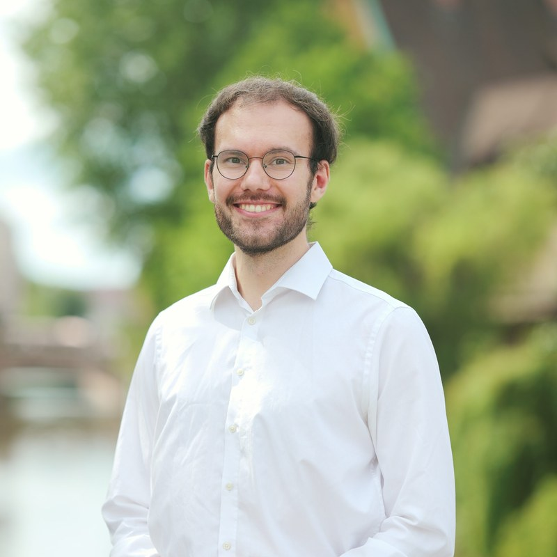

::: {.hero}
{fig-alt="Portrait of Tim Seidel"}

::: {.hero-text}

Tim Seidel

::: {.hero-role}
Doctoral researcher · **[Chair of Communication Science](https://www.kowi.rw.fau.de/)** 
Friedrich-Alexander-Universität Erlangen-Nürnberg
:::

::: {.hero-bio}
I study how people behave and communicate in organizations and what that does to their
well-being, using empirical methods and trying to do it openly and reproducibly.

Short notes on methods and tooling that I find interesting,
you can find on my [blog](blog/index.qmd).
:::

::: {.chips}
- [<i class="bi bi-envelope"></i> tim.seidel@fau.de](mailto:tim.seidel@fau.de)
- [<i class="bi bi-github"></i> GitHub](https://github.com/timseidel)
- [<i class="bi bi-person-badge"></i> ORCID](https://orcid.org/0009-0008-7989-5287)
- [<i class="bi bi-linkedin"></i> LinkedIn](https://linkedin.com/in/tim-benedikt-seidel-576344189/)
- [<i class="bi bi-mortarboard"></i> University profile](https://www.kowi.rw.fau.de/faudir/m-sc-tim-seidel/)
:::
:::
:::

::: {.content-section}

What I am part of:<h2>Projects</h2>

::: {.projects}
- [HYIHY — Social Well-Being from Hybrid Interactions in Hybrid Work](https://www.kowi.rw.fau.de/forschung/forschungsprojekte/hyihy/){.title} 
  [ERC Research project (P. I. Prof. Dr. Adrian Meier) at the Chair of Communication Science]{.note}
- [formr](https://formr.org){.title} 
  [Contributor to the open-source survey framework headed by Prof. Dr. Ruben Lennartz]{.note}
:::
:::

::: {.content-section}

Path<h2>Background</h2>

::: {.timeline}
::: {.row-item}
[Since 06/2026]{.when}

::: {.what}
Doctoral researcher\
[Chair of Communication Science, FAU Erlangen-Nürnberg]{.where}
:::
:::

::: {.row-item}
[08/2024 – 06/2026]{.when}

::: {.what}
Lecturer in statistical software, tutor in organizational psychology\
[Centre for Information Technology, University of Münster]{.where}
:::
:::

::: {.row-item}
[Since 10/2024]{.when}

::: {.what}
M.Sc. Psychology, Personnel and Organizational Psychology\
[University of Münster]{.where}
:::
:::

::: {.row-item}
[10/2020 – 07/2024]{.when}

::: {.what}
B.Sc. Psychology, including an exchange semester at Trinity College Dublin\
[University of Münster]{.where}
:::
:::

::: {.row-item}
[10/2020 – 10/2026]{.when}

::: {.what}
Scholarship holder\
[Cusanuswerk]{.where}
:::
:::
:::
:::

::: {.content-section}

Say hello<h2>Contact</h2>

::: {.timeline}
::: {.row-item}
[Email]{.when}

::: {.what}
[tim.seidel@fau.de](mailto:tim.seidel@fau.de)
:::
:::

::: {.row-item}
[Phone]{.when}

::: {.what}
[+49 911 5302-95675](tel:+49911530295675)
:::
:::

::: {.row-item}
[Office]{.when}

::: {.what}
Findelgasse 7–9, 90402 Nürnberg\
[Room 02.033]{.where}
:::
:::
:::
:::
